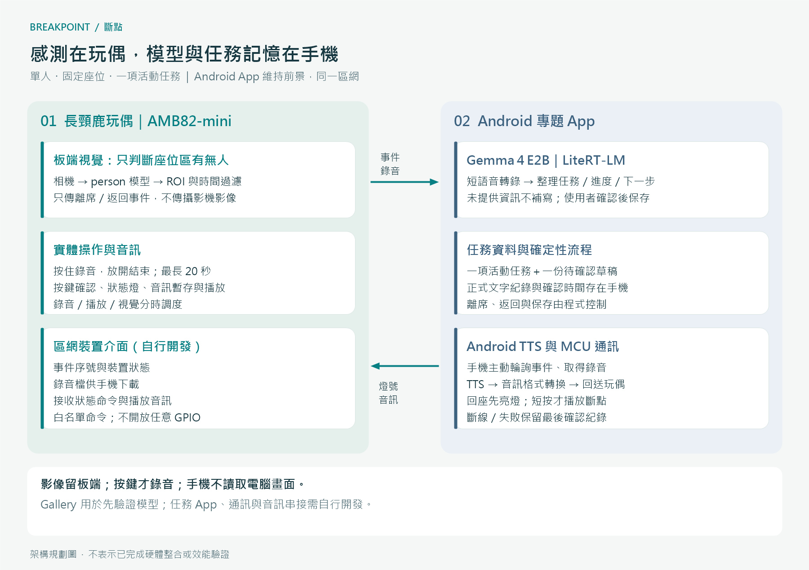
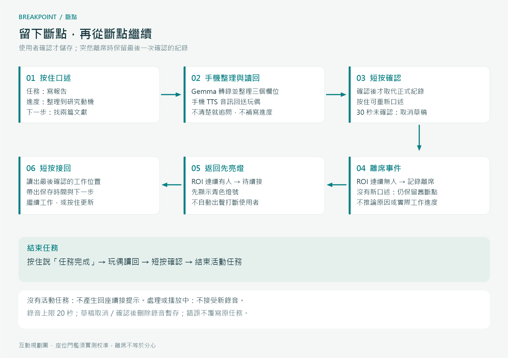
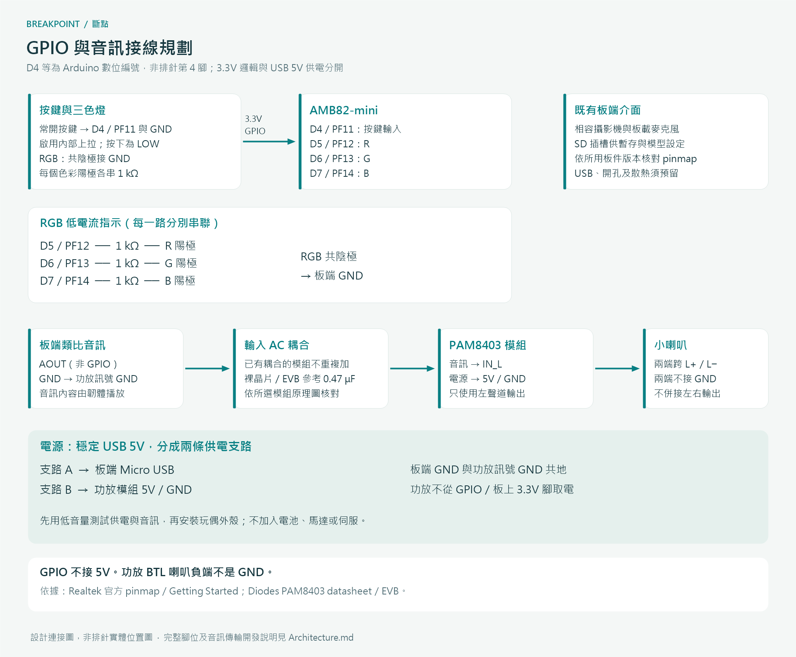

# 斷點｜架構與電路連接規劃

[回到專案首頁](README.md) · [完整提案](PROPOSAL.md)

## 硬體、程式流程與模型分工

- **AMB82-mini：**以板端物件偵測輸出判斷指定座位區內有無 person；其餘以一般程式處理計時、按鍵、錄音、燈號及音訊播放。
- **Android 專題 App：**維持前景，處理區網通訊、音訊格式轉換、任務狀態與文字資料儲存；程式負責何時建立草稿、何時確認及何時播放。
- **Gemma 4 E2B／LiteRT-LM：**在手機轉錄短語音，整理任務、進度與下一步；模型輸出要驗證並由使用者確認。Android TTS 負責合成聲音，模型本身不直接輸出喇叭音訊。
- **Gallery 的角色：**在開發前驗證模型載入與短語音功能；專題採自訂 Android App，不依賴原版 Gallery 提供現成事件伺服器或背景自動化。

官方 [LiteRT-LM Android 文件](https://developers.google.com/edge/litert-lm/android)列有音訊輸入介面；[Gemma 4 模型卡](https://ai.google.dev/gemma/docs/core/model_card_4)列出 E2B 的音訊能力及最長 30 秒音訊。本設計將按鍵錄音限制為 20 秒，中文準確率與效能仍須在目標手機實測。

## 通訊與資料流（專題介面規劃）

手機主動連接 MCU 的區網 HTTP 介面，輪詢帶序號的事件、取得錄音檔，並回送狀態與播放音訊。事件序號與請求編號用來避免輪詢、重傳造成重複儲存或播放；這些介面需自行開發，並非教師範例已具備的能力。

| 方向 | 資料 | 處理規則 |
|---|---|---|
| MCU → 手機 | 按鍵／錄音就緒、離席／返回、裝置狀態 | 不傳攝影機影像；離席只改變互動狀態。 |
| MCU → 手機 | 最長 20 秒的按鍵錄音 | 手機解碼並轉成模型可接受的單聲道音訊；目標為 16 kHz、16-bit PCM/WAV。 |
| 手機內部 | 任務標題、最後口述進度、下一步、確認時間、任務狀態 | 只長期保留已確認的口述轉寫及欄位；未提供的欄位不得臆測。一次一項活動任務。 |
| 手機 → MCU | 燈號狀態、讀回／續接音訊、播放識別碼 | TTS 音訊解碼／轉換為板端播放模組支援格式後傳送；初始採 PCM 16 kHz／16-bit／mono，於音訊里程碑驗證。 |
| 使用者 → 系統 | 短按確認、重新口述、完成意圖 | 草稿不等於正式任務；確認後才覆寫或結束。 |

裝置以開發時設定的 IP／配對代碼建立單一手機連線；只接受已配對端的白名單命令與有長度限制的音訊，不開放網際網路控制。錄音及音訊端點都屬區網設計，不將「無雲端推論」誤寫成「不需要 MCU 與手機連線」。

## 互動與座位判斷

### 按鍵及任務狀態

- 按住達 0.5 秒進入錄音，放開停止；20 秒自動停止，同一次長按不得再觸發短按。
- 手機處理後讀回草稿，讀回結束後短按確認；按住重新錄音。30 秒無操作則取消草稿。
- 回座燈號待確認時，短按播放最後確認的斷點；一般活動任務待命時短按可重播該紀錄。無任務時短按只提示按住錄音。
- 「任務完成」先產生結束草稿，確認後才結束活動任務，不以單次辨識文字直接刪除進度。
- 處理中與播放中不接受新的錄音／確認；以燈號告知使用者等待，重複按鍵不加入佇列。
- 如果語音聽不清、摘要缺少必要的任務或進度，要求重說；下一步未提供時追問或明示「未提供」，不自動生成已確認事實。

### 座位事件

固定攝影機朝向使用者上半身，在畫面設定座位 ROI，使用 person 邊界框中心是否進入 ROI 作判斷。初始規劃信心門檻 0.6、有效無人連續 15 秒判離席、有人連續 3 秒判返回；這些是待校準的工程參數，不是辨識效能保證。

系統啟動或重新取得視覺管線時先建立穩定基準。只有活動任務已建立，且觀察到在座→離席→返回的完整轉換，才產生續接提示。只有有效推論影格才參與計時；視覺暫停、錯誤或錄音／播放期間不累加「無人」時間，恢復時重新建立連續判斷。

該方法辨識的是 ROI 內有無人，不辨識回來的是誰，不觀察螢幕、眼神或專注程度。偵測到多人或推論錯誤時暫停自動續接提示，仍可用按鍵重播已確認紀錄。遮擋可能造成漏判，不能只靠 person 模型自動識別遮擋；路人恰好占據座位區也可能誤判，均列入測試，不將 ROI 稱為身分驗證。

## 電路連接規劃

以下使用官方 AMB82-mini pinmap 的 **Arduino 數位編號與 SoC 名稱**，不表示排針的實體位置。若使用不同板件版本，須重新比對官方圖。

| 板端／介面 | 外接端 | 接法 |
|---|---|---|
| D4／PF11 | 常開按鍵 | 另一端接 GND；啟用內部上拉，按下為 LOW；程式去彈跳。 |
| D5／PF12 | RGB 的 R 陽極 | 串 1 kΩ，燈共陰極接 GND。 |
| D6／PF13 | RGB 的 G 陽極 | 串 1 kΩ，燈共陰極接 GND。 |
| D7／PF14 | RGB 的 B 陽極 | 串 1 kΩ，燈共陰極接 GND。 |
| AOUT | PAM8403 IN_L | 經輸入 AC 耦合；若所選模組已含耦合電容，直接接模組音訊輸入，避免重複配置。 |
| GND | 功放訊號 GND／LED／按鍵地 | 共地；GPIO 使用 3.3V 邏輯，不接入 5V。 |
| 板端 Micro USB | USB 5V 支路 A | 依官方方式供電，不以 GPIO 當電源。 |
| 功放 5V／GND | USB 5V 支路 B | 獨立供電支路，與板端共地；依所選模組規格選喇叭。 |
| 功放 L+／L− | 喇叭兩端 | BTL 輸出，不接 GND，不將 L/R 輸出併接。 |
| 板端相容相機、板載麥克風、SD 插槽 | 既有介面 | 沿用板件接線；不占上述外接按鍵與燈號腳位。 |

按鍵及 RGB 為低電流指示用途，不從 GPIO 直接驅動喇叭、功放或其他大負載。PAM8403 裸晶片的輸入需 AC 耦合，資料手冊／評估板可參考 0.47 μF；採模組時必須查看該模組原理圖，不能假設所有同名模組的輸入與增益相同。先低音量測試，確認無失真、雜訊與供電壓降，再安裝玩偶外殼。

外殼固定攝影機角度，麥克風與喇叭分開開孔，板件使用可拆卸支架並預留散熱與 USB 開口。功能設計採 USB 供電，無充電電池、輪式底盤或伺服關節。

## 錯誤處理與資料保留

- 手機中斷連線、模型失敗或音訊處理失敗：保留正式任務，不覆寫為空值；錯誤燈號提示重新連線／重說。
- 重連後同步最後確認的任務與裝置狀態，先重新建立座位基準，不重播累積的過期返回事件。
- 未配對或格式不符命令拒絕；不讓模型輸出任意 GPIO、PWM 或檔案路徑。
- 影像不儲存、不上傳。錄音僅在按鍵後進行，亮燈提示；正式確認、取消或草稿逾時後，刪除兩端錄音與讀回暫存檔。未傳完的錄音最多保留 60 秒，逾時清除並告知重錄。
- 原始錄音不加入聊天歷史；手機只長期保存使用者確認的文字與狀態，提供手動刪除。應用重啟或取消操作不把未確認草稿升格為正式紀錄。
- App 保持前景是初始展示條件，不宣稱具備完整 Android 背景服務、休眠喚醒或遠端推播能力。

## 官方依據

1. [AMB82-mini Getting Started／官方 pinmap 與 Micro USB 供電](https://ameba-doc-arduino-sdk.readthedocs-hosted.com/en/latest/ameba_pro2/amb82-mini/Getting_Started/Getting%20Started%20with%20Ameba.html)
2. [GPIO 3.3V 高電位官方支援討論](https://forum.amebaiot.com/t/gpio-pins-output-voltage/3932)
3. [AMB82-mini 物件偵測範例](https://github.com/Ameba-AIoT/ameba-arduino-doc/blob/main/source/ameba_pro2/amb82-mini/Example_Guides/Neural%20Network/Object%20Detection.rst)
4. [AMB82-mini 按鍵錄音與傳送範例](https://github.com/Ameba-AIoT/ameba-arduino-doc/blob/main/source/ameba_pro2/amb82-mini/Example_Guides/Neural%20Network/Multimedia%20AI/Generative%20AI%20Speech.rst)
5. [Google LiteRT-LM Android](https://developers.google.com/edge/litert-lm/android)、[Gemma 4 模型卡](https://ai.google.dev/gemma/docs/core/model_card_4)、[Gallery](https://github.com/google-ai-edge/gallery)
6. [PAM8403 datasheet](https://www.diodes.com/datasheet/download/PAM8403.pdf)、[PAM8403 EVB User Guide](https://www.diodes.com/assets/Evaluation-Boards/PAM8403-User-Guide.pdf)

這些來源支持個別硬體或軟體能力；本專題的狀態機、傳輸、格式轉換與整合流程須另行開發及測試，不以來源範例代替整合驗證。
