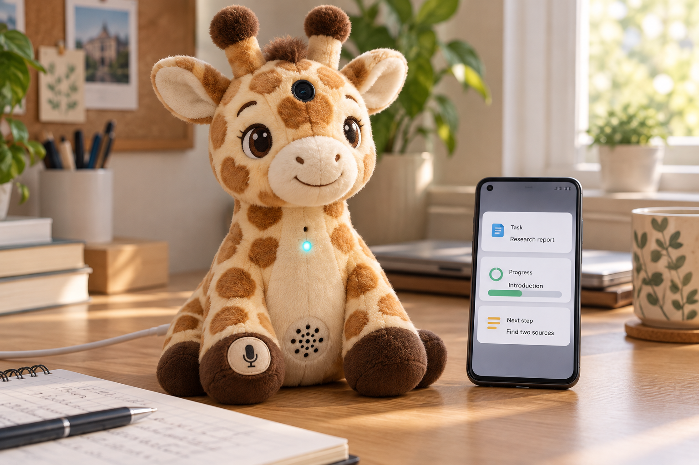
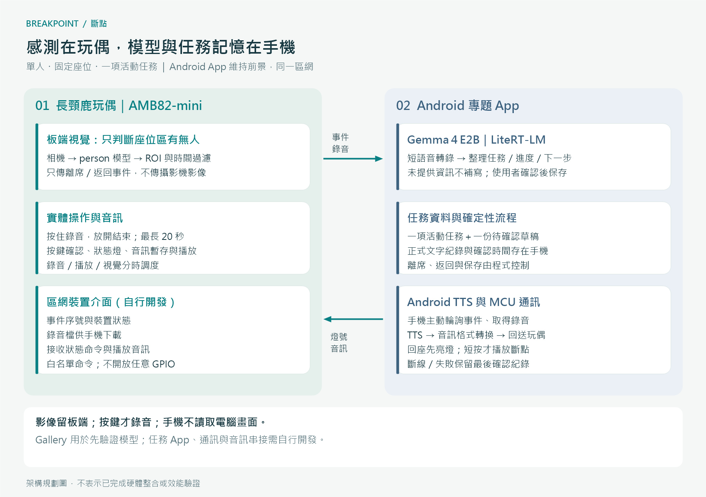
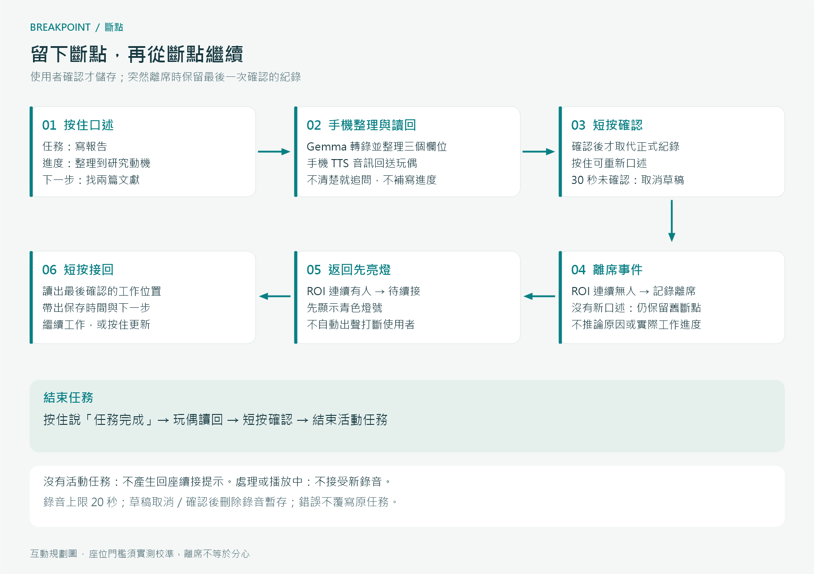
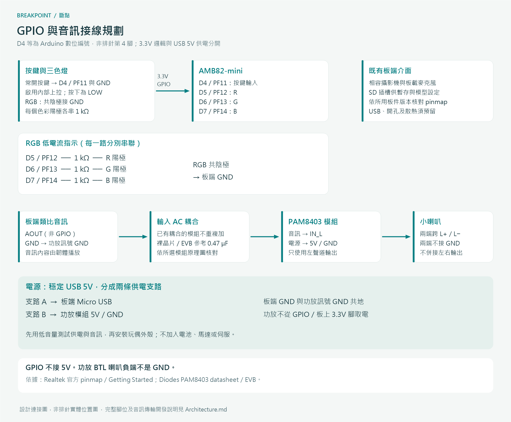

# 斷點｜AI 長頸鹿任務續接夥伴

**先留下進度，回來就有起點。**

為讀書、寫報告與做專題時容易被打斷的大學生，設計一隻能接收口述進度、感知離席與返回，並在使用者確認後提示下一步的桌面長頸鹿。



> AI 生成產品概念圖，非成品照片。鏡頭、按鍵、指示燈與喇叭位置為外觀規劃；手機畫面為概念介面，並非系統自動量測的完成百分比。[生成工具與提示詞](assets/IMAGE_PROMPT.md)

[完整專題提案](PROPOSAL.md) · [架構與接線規劃](Architecture.md)

## 為什麼做「斷點」？

正在寫研究動機，臨時離開處理事情；回到桌前，卻要重看文件才想起做到哪裡。本專題聚焦這段「重新開始」的過程。

使用者先用一句話留下工作位置，再由玩偶於回座時提供溫和提示。創新重點是將**實體口述、座位事件與經確認的任務記憶**串成續接流程；研究目標是探討它是否能降低回想負擔，不預先宣稱有效或全球首創。

## 五個核心功能

| 功能 | 如何運作 |
|---|---|
| 口述斷點 | 按住玩偶按鍵說話，放開即結束；單次上限 20 秒。 |
| 確認後才記住 | 手機 AI 整理「任務／目前進度／下一步」，玩偶讀回；短按確認才取代舊紀錄。 |
| 感知離席與返回 | AMB82-mini 在固定座位區判斷有無人形，加入持續時間過濾。 |
| 回來先亮燈 | 返回後先顯示燈號，短按才讀出最後確認的斷點，不直接出聲打斷。 |
| 更新或結束任務 | 再次口述更新進度，或說「任務完成」並確認結束。 |

**突然離席時，系統保留最後一次確認的進度；它不會讀取螢幕，也不會自動知道你剛剛做到哪裡。**

## 一次互動示例

1. **記錄**：按住按鍵說：「我要寫報告，目前整理到研究動機，下一步找兩篇文獻。」
2. **確認**：玩偶讀回整理內容；短按確認，才儲存在手機。
3. **暫離**：使用者離開座位，玩偶記錄離席事件。
4. **返回**：回座後狀態燈亮起；短按接回任務。
5. **續接**：玩偶說：「上次在整理研究動機，下一步是找兩篇文獻。」
6. **結束**：按住說「任務完成」，讀回後短按確認。

未說明下一步時，系統會追問或保留「未提供」，不把模型猜測寫成使用者的進度。若沒有新的斷點，提醒會帶出最後保存時間，避免把舊紀錄當成即時狀態。

## 系統功能方塊圖



### 板端：感測與實體互動

AMB82-mini 使用單一人形物件偵測模型，觀察指定座位區；處理按鍵、錄音、燈號、音訊播放與 Wi-Fi 通訊。相機影像留在板端，只傳送事件，不做人臉身分辨識。

### 手機端：模型與任務記憶

自行開發 Android 專題 App，透過 LiteRT-LM 在手機執行 **Gemma 4 E2B**，處理短語音轉錄、任務整理、確認後儲存，以及 Android TTS。App 主動取得板端事件與錄音，將播放音訊回送玩偶。

Google AI Edge Gallery 用於先驗證目標手機能否執行模型；**安裝原版 Gallery 不會自動具備本專題的 MCU 通訊與任務管理功能**。模型、App 與韌體串接均為本提案的開發工作。[官方 Android 推論介面](https://developers.google.com/edge/litert-lm/android)

## 操作與狀態



| 狀態 | 燈號規劃 | 按鍵操作 |
|---|---|---|
| 無活動任務／一般待命 | 熄滅／低亮度白光 | 按住開始口述。 |
| 錄音中 | 藍色常亮 | 放開結束；20 秒自動停止。 |
| 手機處理中 | 藍色慢閃 | 不接受新的錄音；只處理當次請求。 |
| 等待儲存或結束確認 | 黃色慢閃 | 短按確認；按住重新口述。 |
| 返回、等待續接 | 青色慢閃 | 短按播放最後確認的紀錄。 |
| 連線／處理異常 | 紅色間歇閃爍 | 提示重試；舊紀錄保留。 |

確認草稿 30 秒無操作則取消，不覆寫舊紀錄。進入錄音或讀回時，先暫停其他提示；錄音、播放與視覺管線以分時調度降低資源衝突，暫停的影格不列入離席時間。

## 硬體與電路規劃

| 材料 | 用途 |
|---|---|
| AMB82-mini 與相容攝影機、板載麥克風 | 人形偵測與按鍵錄音 |
| 常開按鍵 ×1 | 按住錄音、短按確認或接回 |
| 共陰極 RGB LED ×1、1 kΩ 電阻 ×3 | 低電流狀態指示 |
| PAM8403 音訊放大模組、小喇叭 | 將板端類比音訊放大播放 |
| microSD | 模型／錄音與播放檔案的暫存空間，配合 SDK 設定 |
| 穩定 USB 5V 電源與兩條供電支路 | 板端 Micro USB 與功放模組各自供電 |
| Android 手機、長頸鹿玩偶、固定支架與接線材料 | 手機推論與桌面外殼 |



- 按鍵：**D4／PF11 → 常開按鍵 → GND**，使用內部上拉。
- RGB：**D5／PF12、D6／PF13、D7／PF14** 各經 **1 kΩ** 接 R/G/B，LED 共陰極接 GND。
- 音訊：**AOUT → AC 耦合輸入 → PAM8403 IN_L**，並共接訊號 GND；所選模組若已有輸入耦合電容，不再重複加裝。
- 喇叭只跨功放 **L+／L−**；兩端都不接 GND。功放以 USB 5V 獨立支路供電，不使用 GPIO 或板上 3.3V 腳供電。
- **D4 等是 Arduino 數位編號，不是排針的第 4 腳**。攝影機、麥克風與 SD 使用板端既有介面；組裝前依所用板版本核對腳位與模組原理圖。

詳細依據與限制見 [架構與接線規劃](Architecture.md#電路連接規劃)。

## 專題邊界與驗證方向

設計限定單人、固定座位、一次一項任務，手機與玩偶在同一區網，展示時 App 維持前景。離席事件不代表分心，也不辨識是不是同一個人回來。

規劃驗證座位判斷、中文口述、確認保存、斷線恢復與玩偶播放；再以小規模交錯順序測試，比較有無續接提示時重新開始工作的時間與感受。所有門檻與效能數字都是設計目標，非實測成果。

預設影像不離開板端；按鍵才錄音，確認、取消或草稿逾時後刪除錄音暫存。手機保留可由使用者刪除的文字任務紀錄，不加入雲端同步。

## 文件與素材

```text
PROPOSAL.md            專題提案
README.md              專案入口
Architecture.md        分工、互動與接線依據
assets/
  product-concept.png  AI 生成產品示意圖
  system-architecture.png / .svg
  interaction-flow.png / .svg
  wiring-plan.png / .svg
  IMAGE_PROMPT.md      圖像來源與提示詞
```

教師原始程式與 Skill 可留作參考；本題的功能與架構以本提案為準，不將教師介面範例視為已串接好的「斷點」系統。

## 參考與致謝

- 專案起點：[rkuo2000／AI-plush-giraffe 教師範例](https://github.com/rkuo2000/AI-plush-giraffe)。
- Realtek：[AMB82-mini 開發文件與接線圖](https://ameba-doc-arduino-sdk.readthedocs-hosted.com/en/latest/ameba_pro2/amb82-mini/Getting_Started/Getting%20Started%20with%20Ameba.html)、[物件辨識](https://github.com/Ameba-AIoT/ameba-arduino-doc/blob/main/source/ameba_pro2/amb82-mini/Example_Guides/Neural%20Network/Object%20Detection.rst)、[按鍵錄音與傳送](https://github.com/Ameba-AIoT/ameba-arduino-doc/blob/main/source/ameba_pro2/amb82-mini/Example_Guides/Neural%20Network/Multimedia%20AI/Generative%20AI%20Speech.rst)。
- Google：[LiteRT-LM Android](https://developers.google.com/edge/litert-lm/android)、[Gemma 4 模型說明](https://ai.google.dev/gemma/docs/core/model_card_4)、[AI Edge Gallery](https://github.com/google-ai-edge/gallery)。
- Diodes：[PAM8403 資料手冊](https://www.diodes.com/datasheet/download/PAM8403.pdf)、[評估板輸入耦合參考](https://www.diodes.com/assets/Evaluation-Boards/PAM8403-User-Guide.pdf)。

文件與視覺由 AI 協助整理；架構選擇、互動機制與可行性界線均以本專題設定及官方資料為依據。
